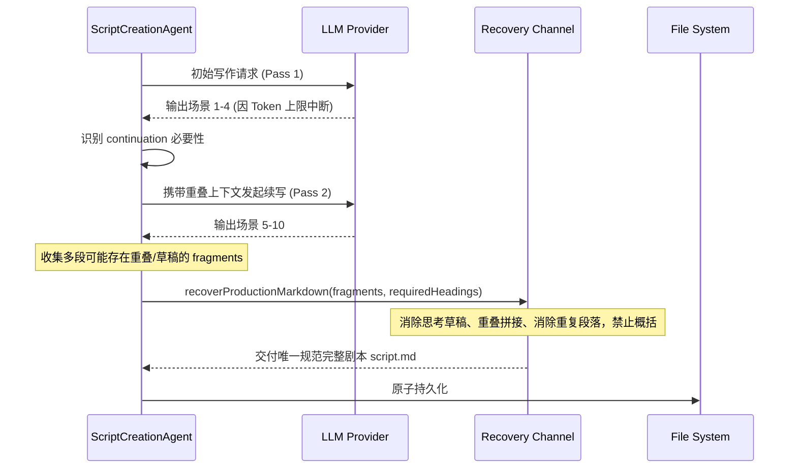

# 剧本阶段三：视听化正文创作与长文本续写恢复（Screenplay Writing & Continuation Recovery）深度分析报告

> **源工程**：`inkos/`  
> **核心源文件**：
> - `inkos/packages/core/src/agents/script-storyboard.ts` (`ScriptCreationAgent`, `recoverProductionMarkdown`)
> - `inkos/packages/core/src/llm/long-form-completion.ts`
> - `inkos/packages/core/skills/inkos-script-writing/SKILL.md`
> - `inkos/packages/core/skills/inkos-script-writing/references/episode-scene-craft.md`
> - `inkos/packages/core/src/__tests__/long-form-completion.test.ts`

---

## 1. 阶段概述

剧本正文创作阶段（Screenplay Writing）解决的是**将抽象的情节大纲转化为符合工业拍摄标准、具备强视听冲击力的剧本成稿**。该阶段面临两大技术与艺术挑战：
1. **文学挑战**：剧本禁止小说式的心理描写，必须做到“一切内心活动外化为摄影机可拍、演员可演的动作与视听元素”；
2. **工程挑战**：单部剧本动辄上万字，极易触发大模型单次生成的输出 Token 上限。InkOS 在底层研发了 **长文本续写与多片段规范恢复机制（`completeLongForm` + `recoverProductionMarkdown`）**，彻底攻克长剧本输出中断与内容撕裂难题。

---

## 2. 执行主体与角色编排

- **ScriptCreationAgent（编剧子代理）**：负责具体的场景搭建、动作行撰写与对白打磨。
- **LongFormCompletion Engine（长文本续写引擎）**：监控 LLM 的 `finish_reason`，当因达到 token 上限（`length`）截断时自动触发 continuation 多轮续写。
- **Production Recovery Agent（生产恢复通道）**：在多轮续写完成后介入，消除拼接重叠词与草稿噪音，重构为标准 Markdown。

---

## 3. 输入契约与上下文来源

- **剧本创作规格书（script-spec.md）**：明确目标集数、时长、受众心理。
- **人物小传与角色列表（Character List）**：人物年龄、核心社会身份、说话口吻特征（Voice）。
- **场景大纲与关键揭示事件**。
- **剧本技能规范（inkos-script-writing）**：注入标准剧本排版与视听化创作方法。

---

## 4. 输出产物与权威形态

- **标准格式剧本成稿（script.md）**：
  包含两个顶层强制小节：
  1. `## 人物（Characters）`：出场具名人物名录与简要特征；
  2. `## 剧本正文（Script）`：按场次（Scene）严格排列的分场剧本。

---

## 5. 核心流转机制与关键算法

### 5.1 视听化动作行与对白三大法则（Audio-Visual Principles）
技能铁律要求：
1. **摄影机只拍可感之物**：
   - 错误写法：“张伟感到内心无比痛苦与悔恨，想起了十年前的往事。”
   - 正确写法：“张伟颤抖着握紧拳头，指甲掐入掌心渗出血迹。他猛地拉开抽屉，将泛黄的旧全家福反扣在桌上。”
2. **台词必须改变博弈力量**：
   - 台词禁止沦为背景解说工具；
   - 每一句对白都在争夺对话主导权、试探底牌或转移矛盾。
3. **关键证据验证的不可自替原则**：
   - 当剧情反转依赖修改数字、日期或证物记录时，剧本必须明确区分“错误原值”与“核实真值”，并具体展现角色核实与记录的过程，严禁出现逻辑自证循环。

### 5.2 长剧本续写与断点恢复架构（Long-Form Continuation & Recovery）



### 5.3 生产恢复提示词（recoverProductionMarkdown）
```typescript
// packages/core/src/agents/script-storyboard.ts:52
const systemContent = [
  "你负责在模型因输出上限续写后，恢复唯一一份规范生产文档。",
  "输入片段可能包含思考草稿、重叠后缀和从头重写的完整文档。",
  "返回且只返回一份完整 Markdown 交付稿。保留用户要求和完成度最高的可用内容；删除流程说明、思考草稿、包装文本、重复文档开头和重复小节。",
  "不得概括或缩短实际交付内容。",
].join("\n");
```
通过低温（`temperature: 0.1`）高上限（`maxTokens: 32000`）单次提纯，确保万字剧本一字不漏地无缝拼接。

---

## 6. 数据结构与剧本标准 Markdown 格式

标准剧本正文必须符合行业格式约定：
```markdown
## 人物
- **苏晴**：28岁，冷库财务出纳，冷静克制，眼神敏锐。
- **赵大勇**：45岁，冷库车间主任，体型魁梧，右手有烫伤疤痕。

## 剧本正文

### 第1集：深夜来客

**第1场：冷库收发室 - 内 - 夜**
△ 昏黄的白炽灯在铁皮屋顶下摇晃，风雪拍打着满是冰霜的窗玻璃。
△ 苏晴独自坐在办公桌前，戴着棉手套快速翻阅一本泛黄的发票存根。
△ 门把手突然转动，发出刺耳的金属摩擦声。苏晴动作一顿，合上账本藏入桌下夹层。
△ 门被猛地推开，赵大勇裹着风雪站在门口，军大衣上挂满白霜，呼吸粗重。

赵大勇
（四下打量，咧嘴笑）
苏会计，这么晚了还不下班？大年三十查账，给谁看呢？

苏晴
（面色平静地摘下手套）
赵主任不也没走吗？三号冷库的温控记录还没送过来。
```

---

## 7. 质量门禁与强校验规则

1. **必需标题校验（Required Headings Guard）**：
   - 英文剧本必须包含 `## Characters` 与 `## Script`；中文剧本必须包含 `## 人物` 与 `## 剧本正文`。缺少标题直接判定为残缺稿件并触发重整。
2. **非空断言（assertNonEmptyArtifacts）**：
   - 生成的 `script.md` 必须通过非空检验与最小篇幅检验，防止续写异常产生空文件。

---

## 8. 一致性与因果链保障

- **台词口吻锁定（Character Voice Continuity）**：
  角色的用词习惯（如受教育程度、口头禅、攻击性强弱）贯穿全剧，严禁后文突然出现语言风格突变。
- **道具与状态守恒**：
  若第 1 场中某角色“右手烫伤”，后续动作行中凡涉及该角色的肢体动作，必须尊重该物理损伤，不可前后矛盾。

---

## 9. 创作技能与专业方法论

技能 `inkos-script-writing` 的核心准则：
- **拒绝宣讲式台词（No Soapboxing）**：角色说话必须服务于当下博弈，严禁借角色之口向观众直接灌输编剧的世界观大道理。
- **视听留白与潜台词（Subtext）**：最顶级的戏剧张力往往来自“说话的内容”与“角色的行动”背道而驰。

---

## 10. 测试覆盖与验证场景

主要测试位于 `inkos/packages/core/src/__tests__/long-form-completion.test.ts` 与 `script-storyboard.test.ts`：
1. **多段续写恢复测试**：模拟被断开的剧本片段（包含重复重叠部分），验证 `recoverProductionMarkdown` 能够准确输出单一份干净连续的剧本文档。
2. **标头结构测试**：验证输出剧本包含合规的人物列表与场次划分标记。
