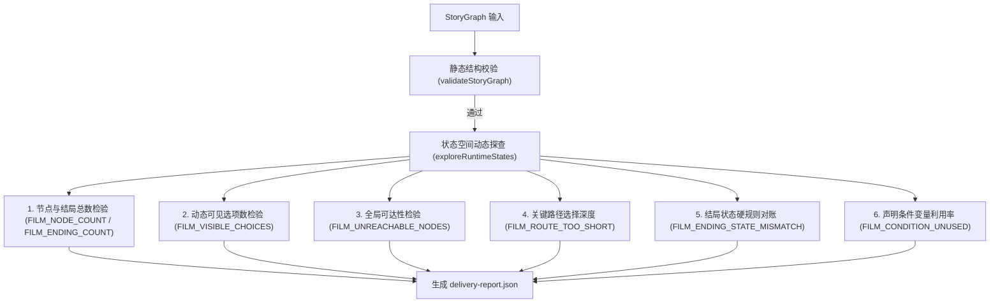

# 剧本阶段六：可达性探查、结局规则校验与交付对账（Validation & Delivery Verification）深度分析报告

> **源工程**：`inkos/`  
> **核心源文件**：
> - `inkos/packages/core/src/interactive-film/delivery-requirements.ts`
> - `inkos/packages/core/src/interactive-film/validation.ts`
> - `inkos/packages/core/src/interactive-film/paths.ts`
> - `inkos/packages/core/src/interactive-film/evaluator.ts`
> - `inkos/packages/core/src/__tests__/if-validation.test.ts`
> - `inkos/packages/core/src/__tests__/film-delivery.flow.test.ts`

---

## 1. 阶段概述

在多分支剧本和互动影游中，随着选择分支的指数级发散，极易出现**“死胡同（Dead End）”、“孤岛节点（Unreachable Nodes）”、“幽灵结局（无法满足条件的结局）”与“分支选择全部因条件失效而消失”**等致命逻辑破损。本阶段是整个剧本流水线的**自动化形式化验证中心**。通过图遍历与状态空间探索算法（`exploreRuntimeStates`），系统在代码层面对剧情图谱进行穷举对账，生成权威的交付检验报告（`delivery-report.json`），未通过对账的图谱绝不允许交付。

---

## 2. 执行主体与角色编排

- **Graph Validation Engine（静态校验器）**：执行 `validateStoryGraph`，对图拓扑结构的合法性进行第一道静态筛选。
- **Runtime State Explorer（运行时状态探索器）**：执行 `exploreRuntimeStates`，从根节点起深度优先/广度优先遍历所有可能的状态变量排列组合。
- **Delivery Requirements Checker（交付规格审查器）**：执行 `checkFilmRequirements`，比对图谱是否符合立项时作者要求的节点数、结局数、选项数硬指标。
- **PipelineRunner**：收集所有的审查观察项（Observations），若存在严重硬伤则将成稿标记为 `unverified` 或 `issue`。

---

## 3. 输入契约与上下文来源

- **待验证图谱（StoryGraph）**：由生成阶段产出的 `story-graph.json`。
- **交付规格书（delivery-requirements.json）**：立项时约定的硬性门禁指标（`FilmRequirements`）。

---

## 4. 输出产物与权威形态

- **交付检验报告（delivery-report.json）**：
  包含整体验证状态（`status: "checks_passed" | "unverified" | "needs_revision"`）与详细的问题清单（`issues`）。
- **质量观察项集合（Observations）**：
  将形式化验证发现的逻辑缺陷转换为与长篇流水线统一的 `Observation` 格式，供后续修订阶段消费。

---

## 5. 核心流转机制与关键算法

### 5.1 运行时状态空间穷举探索（exploreRuntimeStates）
静态检查无法发现动态条件冲突（例如：某个分支要求好感度 > 50 且好感度 < 30，实际上永远不可达）。
系统通过 `exploreRuntimeStates` 模拟玩家在图谱中的一切可能游玩路线：
1. 维护 `(nodeId, stateHash)` 访问集，防止带环图谱引发死循环；
2. 计算到达每个节点时，玩家身上累积的真实状态池；
3. **计算动态可见选项数（visibleChoiceCount）**：遍历该节点所有出度，调用 `evaluateCondition`，统计在当前状态下真正对玩家可见的选项数。

### 5.2 核心检验指标六大算法



### 5.3 结局状态硬规则对账（Ending State Rules）
编剧要求：“真结局（node_true_ending）必须是主角持有生母信件且探长存活”。
算法逻辑：
```typescript
// packages/core/src/interactive-film/delivery-requirements.ts
if (requirements.endingStateRules?.length) {
  for (const rule of requirements.endingStateRules) {
    // 找到所有能够到达该 ending 节点的实际状态
    const bad = runtime.states.find(
      (entry) => entry.nodeId === rule.nodeId && !rule.conditions.every((c) => evaluateCondition(c, entry.state))
    );
    if (bad) {
      issues.push({
        code: "FILM_ENDING_STATE_MISMATCH",
        expected: rule.conditions,
        actual: bad.state,
        nodeIds: [bad.nodeId],
      });
    }
  }
}
```
若存在任何一条路径无需满足前提条件就能混入真结局，系统立即报告状态失配并阻断交付！

---

## 6. 数据结构与错误代码全集

### 6.1 核心错误代码（Error Codes）及其物理含义
| 错误代号 (Code) | 触发条件与物理含义 | 严重级别 |
| :--- | :--- | :---: |
| `FILM_STRUCTURE_INVALID` | 图拓扑语法错误、节点缺失 ID 或目标不存在 | **Fatal** |
| `FILM_NODE_COUNT` | 实际生成的节点总数与规格要求不符 | **Error** |
| `FILM_ENDING_COUNT` | 实际结局数量少于或多于规格要求 | **Error** |
| `FILM_VISIBLE_CHOICES` | 某节点在特定状态下，玩家能看到的有效选项数低于最低下限（如少于2个） | **Error** |
| `FILM_UNREACHABLE_NODES` | 存在任何从起始点无法遍历到达的死节点 | **Error** |
| `FILM_ROUTE_TOO_SHORT` | 通向核心结局的最优路径太短（选择过少，体验干瘪） | **Warning** |
| `FILM_ENDING_STATE_MISMATCH` | 玩家到达特定结局时的变量状态不满足该结局的法定要求 | **Fatal** |
| `FILM_CONDITION_UNUSED` | 作者明确要求参与条件判定的核心变量从未被分支使用 | **Warning** |

---

## 7. 质量门禁与强校验规则

1. **不可达节点零容忍**：
   - 除非规格中明确开启 `allowUnreachable: true`，否则只要有 1 个节点不可达，交付状态立即标红。
2. **状态剪枝防溢出（State Exploration Cap）**：
   - 若状态空间极其庞大超出预算，系统标记 `runtime.truncated`，并输出 `FILM_ENDING_STATES_NOT_PROVEN` 警告，绝不假装证明通过。

---

## 8. 一致性与因果链保障

- **数学完备性与可证明性**：
  不同于小说审稿依赖大模型的自然语言推测，互动剧本的交付校验完全建立在图论与状态机求值的数学确定性之上，保证交付给引擎或游戏运行时的剧本 100% 不会发生逻辑崩溃。

---

## 9. 创作技能与专业方法论

技能 `inkos-interactive-film` 在校验阶段的指导：
- **拒绝假锁（No Fake Locks）**：如果一个分支选项被挂上了条件锁，必须保证玩家在先前的某些支线中**确实有机会**解锁该条件；
- **全结局可达性自洽**：每个坏结局（Bad Ending）必须让玩家死得明明白白，是由具体某次贪婪或失误直接导致。

---

## 10. 测试覆盖与验证场景

主要测试位于 `inkos/packages/core/src/__tests__/film-delivery.flow.test.ts` 与 `if-validation.test.ts`：
1. **真结局状态拦截测试**：构造一个未持有关键道具即可进入真结局的漏洞图谱，断言抛出 `FILM_ENDING_STATE_MISMATCH`。
2. **选择数不足检测测试**：设置节点仅有 1 个选项有效，断言命中 `FILM_VISIBLE_CHOICES` 缺陷。
3. **闭环全绿交付测试**：输入完全合规的图谱，断言 `delivery-report.json` 给出 `status: "checks_passed"`。
