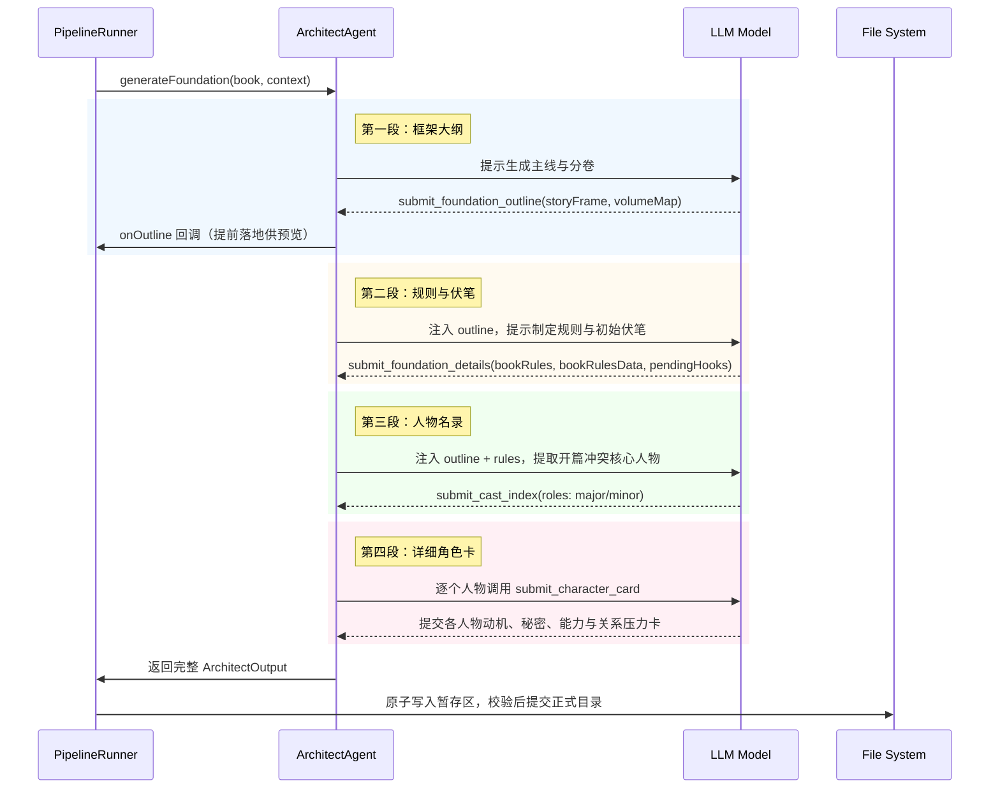

# 阶段三：基础设定（Foundation / Architect）深度分析报告

> **源工程**：`inkos/`  
> **核心源文件**：
> - `inkos/packages/core/src/agents/architect.ts`
> - `inkos/packages/core/src/agents/architect-tool.ts`
> - `inkos/packages/core/src/models/book-rules.ts`
> - `inkos/packages/core/src/models/runtime-state.ts`
> - `inkos/packages/core/src/state/state-projections.ts`
> - `inkos/packages/core/src/state/state-reducer.ts`
> - `inkos/packages/core/src/references/reference-context.ts`
> - `inkos/packages/core/src/utils/outline-paths.ts`
> - `inkos/packages/core/skills/inkos-long-writing/SKILL.md`
> - `inkos/packages/core/skills/inkos-long-writing/references/foundation-design.md`
> - `inkos/packages/core/src/__tests__/book-foundation-complete.test.ts`
> - `inkos/packages/core/src/__tests__/foundation-revision.flow.test.ts`

---

## 1. 阶段概述

基础设定阶段（Foundation）是长篇小说整个世界体系与因果逻辑的基石。该阶段通过 **ArchitectAgent** 将模糊的题材方向拓展为具备高度可执行性、因果自洽的五项核心设定：**故事大纲（StoryFrame）**、**分卷地图（VolumeMap）**、**全书规则（BookRules）**、**初始伏笔（Hooks）** 与 **核心人物卡（Cast & Character Cards）**。InkOS 创新性地采用“单 Child 进程四段式生成”协议，避免了一次性生成超长上下文带来的注意力涣散与质量崩塌。

---

## 2. 执行主体与角色编排

- **ArchitectAgent（架构师子代理）**：专注于宏观架构设计，分步调用结构化工具提交大纲、细节、名录与角色卡。
- **PipelineRunner（流水线编排器）**：负责调度 Architect，捕获阶段性产物（`onOutline` 回调提前落地大纲），并在失败时调用 `preserveFailedWork` 保全现场。
- **StateProjections & StateReducer**：将 Architect 产出的结构化数据转换为初始状态快照与人类可读的投影文件。
- **人类作者（Author Approval Gate）**：审阅生成的基础设定，可触发 `reviseFoundation` 提交反馈进行增量重构，或确认通过进入下一阶段。

---

## 3. 输入契约与上下文来源

- **BookConfig**：包含作品标题、题材、语言、篇幅规划。
- **Control Documents**：`story/author_intent.md`（作者最高指导原则）与 `story/brief.md`（立项外部约束）。
- **写作技能指引**：激活 `inkos-long-writing` 技能，挂载 `foundation-design.md` 参考文档，提供设定结构、冲突层级和人物动机的专业指导。
- **修订输入（可选）**：若属于重新修订（`reviseFrom`），则输入旧版 `storyFrame`、`volumeMap`、`bookRules`、`roles` 与 `userFeedback`。

---

## 4. 输出产物与权威形态

### 4.1 机器权威文件（Single Source of Truth）
- `story/book_rules.json`：符合严格 `BookRulesSchema v2` 的机器可读规则约束。
- `state/hooks.json`：初始伏笔数组，包含唯一 `hookId`、类型、触发章节与预期闭环方案。
- `state/current_state.json`：全书起始世界状态。

### 4.2 文档与只读投影文件（Projections）
- `story/outline/story_frame.md`：核心前提、主线矛盾、动力学机制与终局设定。
- `story/outline/volume_map.md`：全书各卷主线节拍与章纲方向。
- `story/book_rules.md`：供人类阅读的规则与禁忌文档。
- `story/current_state.md` & `story/pending_hooks.md`：由 JSON 自动单向渲染的 Markdown 投影。
- `story/roles/主要角色/<name>.md` & `次要角色/<name>.md`：独立的人物小传与能力边界卡。

---

## 5. 核心流转机制：四段式渐进生成

为了保证在大模型推理能力边界内稳定产出超高质量、结构完备的基础设定，Architect 绝不尝试单次请求输出万字设定，而是按照严格的因果依赖拆分为四段：



---

## 6. 数据结构与 Schema 详述

### 6.1 `FoundationOutlineToolSchema`
```typescript
// packages/core/src/agents/architect-tool.ts
export const FoundationOutlineToolSchema = Type.Object({
  storyFrame: Type.String({ minLength: 1, description: "全书核心前提、中心冲突、主角动机、因果高潮闭环。" }),
  volumeMap: Type.String({ minLength: 1, description: "包含全书分卷目标与开篇章节因果节拍的 Markdown 卷纲。" }),
});
```

### 6.2 `BookRulesSchema v2`（严格模式）
```typescript
// packages/core/src/models/book-rules.ts
export const BookRulesSchema = z.object({
  version: z.literal("2"),
  protagonist: z.object({
    name: z.string(),
    personalityLock: z.array(z.string()),        // 性格不可动摇底色
    behavioralConstraints: z.array(z.string()),  // 行为绝对禁忌
  }),
  genreLock: z.object({
    primary: z.string(),                         // 主类型
    forbidden: z.array(z.string()),              // 绝对禁止杂糅的毒点元素
  }),
  narrativePerson: z.string().trim().min(1).optional(), // 叙事视角（第三人称限知等）
  prohibitions: z.array(z.string()),             // 全书禁忌列表
  enableFullCastTracking: z.boolean(),           // 是否全员状态追踪
  fanficMode: z.string().trim().min(1).optional(),
  allowedDeviations: z.array(z.string()),        // 允许偏离的传统套路
}).strict(); // 严禁多余未知字段
```

### 6.3 初始伏笔 `HookRecord`
```typescript
// packages/core/src/models/runtime-state.ts
export interface HookRecord {
  hookId: string;               // 唯一伏笔标识（如 "hook_ancient_ring_secret"）
  startChapter: number;         // 设下伏笔的章节（初始为 0）
  type: string;                 // 伏笔类型（悬念、危机、宝物、身世）
  status: "open" | "progressing" | "deferred" | "resolved" | "superseded"; // 初始一律 deferred
  lastAdvancedChapter: number;  // 最近推进章节
  expectedPayoff: string;       // 预期兑现效果与闭环设计
  notes: string;                // 关键线索提示
  dependsOn?: string[];         // 前置依赖伏笔
  paysOffInArc?: string;        // 规划兑现的卷/高潮段落
}
```

---

## 7. 质量门禁与强校验规则

### 7.1 基础设定就绪判据（`isCompleteBookDirectory`）
在进入下一阶段前，宿主调用 `isCompleteBookDirectory`，执行物理文件存在性强检查：
1. `book.json` 存在
2. `story/outline/story_frame.md` 存在
3. `story/outline/volume_map.md` 存在
4. `story/book_rules.md` 存在
5. `story/current_state.md` 存在
6. `story/pending_hooks.md` 存在
7. `chapters/index.json` 存在
8. 角色目录（`story/roles/`）下**至少包含一张具名角色卡**。

### 7.2 Schema 强解析门禁
- `BookRulesSchema.parse({ version: "2", ... })` 必须无报错通过；缺字段、类型错误立即中断流程。
- 角色卡提交禁止把“群众演员”或“店小二”建卡，强制只为开篇冲突的具名核心人物（Major/Minor）建立权威卡。

---

## 8. 一致性与因果链保障

1. **角色单一权威（Single Cast Authority）**：
   - 角色卡一经生成，正文阶段严禁擅自修改角色核心设定与性格禁忌；正文只能“展现”角色，不能“重塑”角色。
2. **伏笔生命周期守恒**：
   - 所有在基础设定中提出的悬念均被录入 `hooks.json`，初始状态锁定为 `deferred`。后续章节只有在明确满足兑现或推进动作时才允许流转，防止挖坑不填。
3. **暂存区原子提交保护**：
   - 四段生成全过程在 `.tmp-book-create-*` 目录中进行；任何一段失败直接回滚并保全日志，绝不污染正式作品空间。

---

## 9. 创作技能与专业方法论

技能文件 `foundation-design.md` 明确了优秀长篇设定的文学标准：
- **核心矛盾动力学**：主角面临的初始困境必须具备不可调和性（必须行动，且行动必有代价）。
- **规则不是背景板**：世界观规则必须成为剧情的约束力量，主角必须在规则限制下利用智慧或代价取胜，严禁机械降神。
- **人物卡聚焦即时冲突**：开篇人物卡强调角色的“即时欲望、当下软肋与关系张力”，坚决避免罗列数万字无关紧要的远古族谱。

---

## 10. 测试覆盖与验证场景

主要测试位于 `inkos/packages/core/src/__tests__/book-foundation-complete.test.ts` 与 `foundation-revision.flow.test.ts`：
1. **五段齐备性断言**：断言 Architect 顺利执行完所有阶段后，各文件均成功落地且满足最小字数要求。
2. **规则 Schema v2 校验测试**：模拟畸形规则 JSON，断言 Zod 解析抛出错误阻断流程。
3. **增量修订测试（Revision Flow）**：验证传入 `userFeedback` 后，Architect 能够在保留原有良好设定的基础上精准修补指定设定项。
