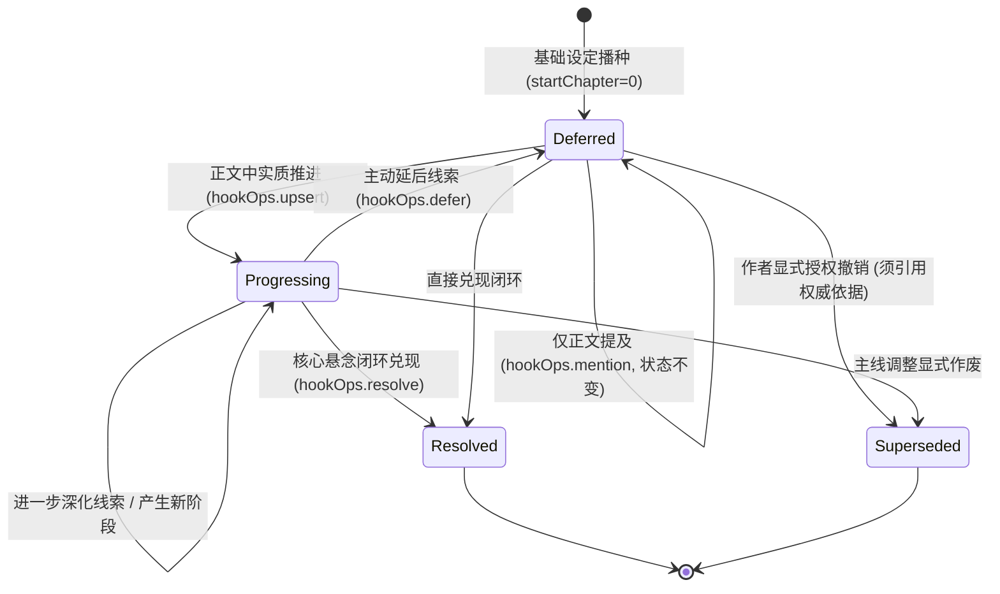

# InkOS 源工程长篇流程各阶段多维度深度分析总揽与研究索引

> **源工程**：`inkos/`（代码库基线：`packages/core/`、`packages/studio/`、`packages/cli/`）  
> **整理位置**：`docs/inkos/longform-pipeline-analysis.md`  
> **长篇全链路**：提案 → 立项/初始化 → 基础设定 → 全书/章前规划 → 正文 → 审稿 → 修订/清稿 → 摘要/结算/定稿  
> **核心原则**：方法与事实分离、规划与事实分离、全量存储与有限上下文分离、机器权威与人读投影分离、提到不等于推进。

---

## 目录

1. [一、长篇流水线 8 个专项研究索引矩阵](#一长篇流水线-8-个专项研究索引矩阵)
2. [二、流水线全景图与因果状态机](#二流水线全景图与因果状态机)
3. [三、源工程核心设计哲学与三大铁律](#三源工程核心设计哲学与三大铁律)
4. [四、八大阶段多维度分析与对比归纳](#四八大阶段多维度分析与对比归纳)
5. [五、横向贯穿机制与关键工程护栏](#五横向贯穿机制与关键工程护栏)
6. [六、对 DSH 复刻的系统性启示](#六对-dsh-复刻的系统性启示)

---

## 一、长篇流水线 8 个专项研究索引矩阵

本套研究对 InkOS 长篇创作流水线的 8 个纵向阶段开展了源码级（函数、Schema、文件路径、测试用例）的深度剖析，各阶段独立研究报告保存在当前目录下：

| 阶段序号 | 阶段名称 | 专项研究报告链接 | 核心源码模块与位置 | 主责角色 / 工具 | 关键产物（权威 vs 投影） | 核心质量门禁 / 阻断断言 |
| :---: | :--- | :--- | :--- | :--- | :--- | :--- |
| **01** | **提案** Proposal | [01-proposal.md](./01-proposal.md) | `packages/core/src/agent/agent-tools.ts` `interaction/action-envelope.ts` | Creative Agent `propose_action` | **产物**：`ActionEnvelope` **说明**：`execution-brief` | **Workflow Start Gate** 禁止未确认私自动笔；指令必须自包含 |
| **02** | **立项/初始化** Init & Binding | [02-init.md](./02-init.md) | `pipeline/runner.ts` (`initBook`) `harness/session-binding.ts` `state/manager.ts` | PipelineRunner StateManager | **权威**：`book.json`, `work.json` **控制**：`author_intent.md`, `brief.md` | **Work Lock 排他锁** 能力白名单校验；禁止覆盖已完成书籍 |
| **03** | **基础设定** Foundation | [03-foundation.md](./03-foundation.md) | `agents/architect.ts` `models/book-rules.ts` `agents/architect-tool.ts` | ArchitectAgent (四段式生成) | **权威**：`book_rules.json`, `hooks.json` **文档**：`story_frame.md`, `volume_map.md`, 角色卡 | **Foundation Ready-Check** 五段齐备性强检；`BookRulesSchema v2` 强解析 |
| **04** | **章前规划** Planning | [04-planning.md](./04-planning.md) | `agents/planner.ts` `agents/composer.ts` `retrieval/local-search.ts` | PlannerAgent ComposerAgent SQLite FTS5 | **规划**：`ChapterMemo`, `governed plan` **注入**：`ContextPackage` **痕迹**：`ChapterTrace` | **Token 预算硬门禁** 伏笔合法性校验；超预算语义压缩 Fail-Fast |
| **05** | **正文创作** Writing | [05-writing.md](./05-writing.md) | `agents/writer.ts` `utils/length-metrics.ts` `agents/writer-prompts.ts` | WriterAgent (零工具写权限) | **初稿**：Markdown 正文 **数据**：`wordCount`, `LengthMetrics` | **Length Metrics 硬检** 中英文分流算法；正文非空断言；`OUT_OF_RANGE` 告警 |
| **06** | **审稿与连续性** Review & Audit | [06-review.md](./06-review.md) | `agents/continuity.ts` `pipeline/chapter-review.ts` `models/observation.ts` | ContinuityAuditor `review_tool` | **报告**：`AuditResult` **记录**：`Observation` (带行号引文) **版本**：`ReviewedArtifact` | **真实引文门禁** 强制引用编号行文本；禁止模型自估字数；严重硬伤阻断 |
| **07** | **修订/清稿** Revision | [07-revision.md](./07-revision.md) | `agents/reviser.ts` `utils/atomic-file-set.ts` `pipeline/runner.ts` | ReviserAgent AtomicFileSet 引擎 | **成品**：`revisedContent` **审计**：`lengthTelemetry`, 事务日志 | **路径安全与事务性** 防路径穿越与重叠；两阶段修改复审；字数二次校验 |
| **08** | **摘要/结算/定稿** Settlement | [08-settlement.md](./08-settlement.md) | `agents/settler-tool.ts` `state/state-reducer.ts` `utils/hook-arbiter.ts` `pipeline/chapter-persistence.ts` | SettlerAgent StateValidator HookArbiter | **权威**：`current_state.json`, `hooks.json` **成书**：`chapters/0001_*.md` **投影**：`current_state.md`, `pending_hooks.md` **快照**：`chapter_0001.json` | **伏笔状态机与对账** 未知伏笔禁止更新；`superseded` 需作者授权；对账冲突阻断 |

---

## 二、流水线全景图与因果状态机

### 2.1 长篇创作闭环全景流程

```mermaid
flowchart TD
    subgraph S1["1. 提案 (Proposal) — [01-proposal.md]"]
        P1["自然语言灵感对话"] --> P2["propose_action 生成 ActionEnvelope"]
        P2 --> P3["作者界面确认卡审批 (Approval Gate)"]
    end

    subgraph S2["2. 立项/初始化 (Init) — [02-init.md]"]
        P3 --> I1["分配 workId，初始化 work.json"]
        I1 --> I2["获取跨进程排他锁 (.write.lock)"]
        I2 --> I3["播种顶层控制文档 (author_intent.md / brief.md)"]
    end

    subgraph S3["3. 基础设定 (Foundation) — [03-foundation.md]"]
        I3 --> A1["ArchitectAgent 单 Child 四段式调用"]
        A1 --> A2["1. submit_foundation_outline (大纲/卷纲)"]
        A2 --> A3["2. submit_foundation_details (BookRules v2 / 初始伏笔)"]
        A3 --> A4["3. submit_cast_index (人物名录)"]
        A4 --> A5["4. submit_character_card (独立角色卡)"]
        A5 --> A6["Ready-Check: 五段齐备性与格式强检"]
    end

    subgraph S4["4. 全书/章前规划 (Planning) — [04-planning.md]"]
        A6 --> PL1["PlannerAgent 制定 ChapterMemo 与节拍"]
        PL1 --> PL2["SQLite FTS5 / BM25 检索历史记忆与伏笔"]
        PL2 --> PL3["ComposerAgent 上下文分层 (受保护层 vs 可压缩层)"]
        PL3 --> PL4["超预算语义压缩 Fail-Fast"]
        PL4 --> PL5["组装 ContextPackage 并记录 ChapterTrace (七字段)"]
    end

    subgraph S5["5. 正文创作 (Writing) — [05-writing.md]"]
        PL5 --> W1["WriterAgent 首版创作 (零外部工具写权限)"]
        W1 --> W2["底层计字引擎监控 (LengthMetrics: 中英分流)"]
        W2 --> W3["生成符合 Markdown 规范的初稿正文"]
    end

    subgraph S6["6. 审稿与连续性 (Review) — [06-review.md]"]
        W3 --> R1["宿主注入行号 (numberReviewSource)"]
        R1 --> R2["ContinuityAuditor 对照规则与记忆审查"]
        R2 --> R3["提取 Observation (强制带行号真实 quote)"]
        R3 --> R4["校验 ReviewedArtifact 版本对齐"]
    end

    subgraph S7["7. 修订/清稿 (Revision) — [07-revision.md]"]
        R4 --> RV1["根据审稿意见选择模式 (spot-fix / rewrite / deslop 等)"]
        RV1 --> RV2["ReviserAgent 生成修订提案 (两阶段修订)"]
        RV2 --> RV3["自动化二次复审通过"]
        RV3 --> RV4["commitAtomicFileSet 事务原子落盘"]
    end

    subgraph S8["8. 摘要/结算/定稿 (Settlement) — [08-settlement.md]"]
        RV4 --> ST1["SettlerAgent 抽取状态差分 (factOps & hookOps)"]
        ST1 --> ST2["HookArbiter 伏笔仲裁 (提到不等于推进)"]
        ST2 --> ST3["StateValidator 语义对账 (背离主干直接阻断)"]
        ST3 --> ST4["原子写入正式章节 chapters/0001_*.md"]
        ST4 --> ST5["汇算并更新 current_state.json / hooks.json (唯一权威)"]
        ST5 --> ST6["单向自动渲染 current_state.md / pending_hooks.md (只读投影)"]
        ST6 --> ST7["落地状态快照 snapshot 与 SQLite 索引更新"]
    end

    ST7 -.->|"形成新基线，驱动下一章"| S4
```

### 2.2 伏笔生命周期状态机（Hook State Machine）

---

## 三、源工程核心设计哲学与三大铁律

### 3.1 三大核心解耦
1. **创作方法（Skill）与作品事实（Fact）彻底分离**：
   - `skills/`（如 `inkos-long-writing`、`inkos-story-review`）只沉淀“如何构思冲突、如何审查伏笔、如何消除 AI 腔”，绝对不包含某本书的具体设定；作品事实由 `story/` 和 `state/` 独立承载。
2. **预期规划（Plan）与既成事实（Grounded State）彻底分离**：
   - 大纲、卷纲、章纲只是**意图预演**；正文中未经结算、未经校验的情节不能自动变成事实。唯有通过 `SettlerAgent` 差分抽取并在事务中提交后，才被承认为不可动摇的既成事实。
3. **全量长期存储与有限任务上下文彻底分离**：
   - 全书档案长期保存在磁盘；每次正文调用仅由 `ComposerAgent` 根据当前任务动态检索、分层拼装最小必要上下文，从物理上破除模型窗口开销与注意力稀释。

### 3.2 三大不可逾越的铁律
1. **单向权威与双轨投影铁律**：
   - 机器可读的结构化 JSON（`current_state.json`、`hooks.json`）是**唯一事实权威（Single Source of Truth）**；供人类阅读的 Markdown（`current_state.md` 等）是由系统自动单向渲染的**只读投影（Projections）**。**严禁系统反向解析 Markdown 作为机器状态**。
2. **伏笔守恒铁律（Mention != Advance）**：
   - 章节正文中提到某件法宝或人物，绝不代表该伏笔已解决；未经作者在控制文档中明确授权撤销，任何 Agent 严禁将伏笔标记为 `superseded`，严禁擅自删减伏笔台账。
3. **不可逆事务与崩溃一致性铁律**：
   - 章节正文落盘、JSON 权威状态增量更新、只读投影渲染、快照归档与全文索引构建，必须在**同一个受保护的原子事务（AtomicFileSet）**内一次性完成。任何一步出错均触发完整回滚。

---

## 四、八大阶段多维度分析与对比归纳

| 分析维度 | 01. 提案 | 02. 立项/初始化 | 03. 基础设定 | 04. 章前规划 | 05. 正文创作 | 06. 审稿审查 | 07. 修订清稿 | 08. 摘要结算定稿 |
| :--- | :--- | :--- | :--- | :--- | :--- | :--- | :--- | :--- |
| **① 阶段定位** | 创意收敛与授权确认 | 物理工程落盘与绑定 | 世界观、规则与初始伏笔 | 微观场景拆解与记忆召回 | 场景驱动的初稿成文 | 客观证据化审读挑刺 | 模式化改稿与事务提交 | 事实差分汇算与状态快照 |
| **② 执行主体** | Creative Agent 人类作者 | PipelineRunner StateManager | ArchitectAgent (单 Child 四段) | Planner / Composer SQLite FTS5 | WriterAgent (无工具写权限) | ContinuityAuditor 宿主行号引擎 | ReviserAgent AtomicFileSet 引擎 | Settler / Validator HookArbiter |
| **③ 输入契约** | 用户初始想法 Profile 动作集 | 批准的 BookConfig 工作区根目录 | `author_intent.md` 写作类型技能 | 卷纲、前章摘要 当前活动伏笔 | `ContextPackage` `ChapterMemo` | 带行号正文 审查技能矩阵 | 章节原文、问题项 指定修订模式 | 定稿正文、前章快照 本书规则与大纲 |
| **④ 输出权威** | 提案确认卡 `execution-brief` | `work.json` `book.json` | `book_rules.json` `hooks.json` | `ChapterMemo` `ContextPackage` | Markdown 初稿文本 `LengthMetrics` | 结构化 `AuditResult` `ReviewedArtifact` | 修订后正文文本 `LengthTelemetry` | 正式章节 MD 更新后 JSON 权威及快照 |
| **⑤ 核心机制** | 自包含指令抽取 封套组装 | 跨进程文件排他锁 控制文档播种 | 渐进四段生成 暂存目录隔离 | 双层上下文治理 超预算语义压缩 | 场景因果闭环铺陈 中英分流统计 | 审计原文编号注入 精确引文校验 | 5 种修订模式 两阶段提案复审 | 状态差分抽取与对账 单向投影自动渲染 |
| **⑥ 质量门禁** | Workflow Start 门禁 非空指令断言 | 能力白名单匹配 已完成书籍防覆写 | Ready-Check 5段齐备 BookRules v2 解析 | 伏笔存在性校验 预算超限 Fail-Fast | 正文非空断言 篇幅上下限硬检 | 拒绝模型估算字数 致命硬伤强制阻断 | 相对路径越界拦截 事务重叠路径防御 | 未知伏笔禁止更新 非法作废伏笔拦截 |
| **⑦ 一致性保障** | 执行简报哈希锚定 | Work Lineage 锁死 | 单一角色权威 初始伏笔状态锁定 | 上章结尾强制注入 ChapterTrace 溯源 | 时空站位强行继承 战力数值绝不逾越 | 跨版本审计隔离 差分修订聚焦改动 | 状态自动回溯废弃 多轮修改说明合并 | 不可逆单向渲染 N-1 快照历史回滚 |
| **⑧ 文学考量** | 明确读者类型期待 | 确立最高创作宪法 | 规则作为剧情阻碍 | 确保产生不可逆变化 | 展现优于直接灌输 | 识别虚假推进与漏洞 | 语义脱油去除 AI 腔 | 区分伏笔提及与推进 |

---

## 五、横向贯穿机制与关键工程护栏

### 5.1 跨进程作品锁（Work Lock）与提交安全（AtomicFileSet）
- **痛点**：长篇小说单章创作动辄数十秒至数分钟，并发写入或意外中断极易导致设定与正文撕裂。
- **机制**：
  1. **作品排他锁（`.write.lock`）**：进入任何管线必须先取得锁，锁记录持有进程与时间戳；
  2. **事务日志（Journaling）**：写入前在目标根目录记录 `.atomic-journal.json`；
  3. **影子临时写入（Shadow Files）**：写入 `.tmp-*` 隐藏文件，校验无误后通过 `rename` 原子覆盖；
  4. **崩溃自动自愈**：每次事务开始前先调用 `recoverAtomicFileSets`，自动扫描未完成的影子文件并按日志回滚。

### 5.2 上下文全链路追踪技术（ChapterTrace 七大核心字段）
每创作一章均会记录一份技术审计日志 `ChapterTrace`，由七个核心要素组成：
1. `plannerInputs`：章纲规划阶段读取的所有文件；
2. `composerInputs`：装配阶段读取的候选素材；
3. `selectedSources`：最终入选正文 Prompt 的素材清单；
4. `contextTiers`：分层归属（`protectedSources` vs `compressibleSources`）；
5. `tokenBudget`：Token 消耗账单（保护层消耗、压缩层消耗、实际注入总量）；
6. `compression`：语义压缩痕迹（压缩前尺寸、压缩后尺寸、摘要编译器输出）；
7. `retrieval`：SQLite FTS5 检索审计（检索使用的 Query、候选打分排名、被选中的实体 ID）。

### 5.3 确定性快照与状态回滚（Snapshot & Reopen）
- **第 N-1 章快照恢复**：系统在 `state/snapshots/chapter_<N>.json` 保存每次结算后的完整世界状态切片。
- 当发生坏章需要重写或向前回溯时，系统**拒绝使用粗暴的 Git reset**，而是从指定快照中一键还原 `current_state.json` 与 `hooks.json`，并重新同步 SQLite FTS5 索引，确保世界线回退时无任何幽灵数据残留。

---

## 六、对 DSH 复刻的系统性启示

在将 InkOS 高保真复刻到 DeepSeek-Harness（DSH）体系时，根据 `AGENTS.md` 铁律与映射原则，必须严格贯彻以下要点：

1. **运行时机制等价落盘**：
   - InkOS 原生的自定义 Runner 映射为 DSH 的 **Agent Loop + Subagents**；
   - InkOS 的 Prompt 组装层映射为 DSH 的 **`systemPrompt.context()` 主动阶段注入**，技能只保留“怎么写”，严禁在技能内编写工具调用流程。
2. **工作台与面板状态映射**：
   - 前端面板基于 `panel.index.json` 单向投影驱动渲染，不反向控制状态；
   - 作者确认动作严格对齐 `ActionEnvelope` 语义，通过 DSH 的 `approval` 服务与 `panel.confirm` 协同承接。
3. **数据一致性底线**：
   - 必须原汁原味继承 InkOS 的双轨存储模型（JSON 唯一权威 + Markdown 只读投影）；
   - 保持 FTS5 检索、双层上下文分层与超预算 Fail-Fast 机制，杜绝模型上下文静默截断。
