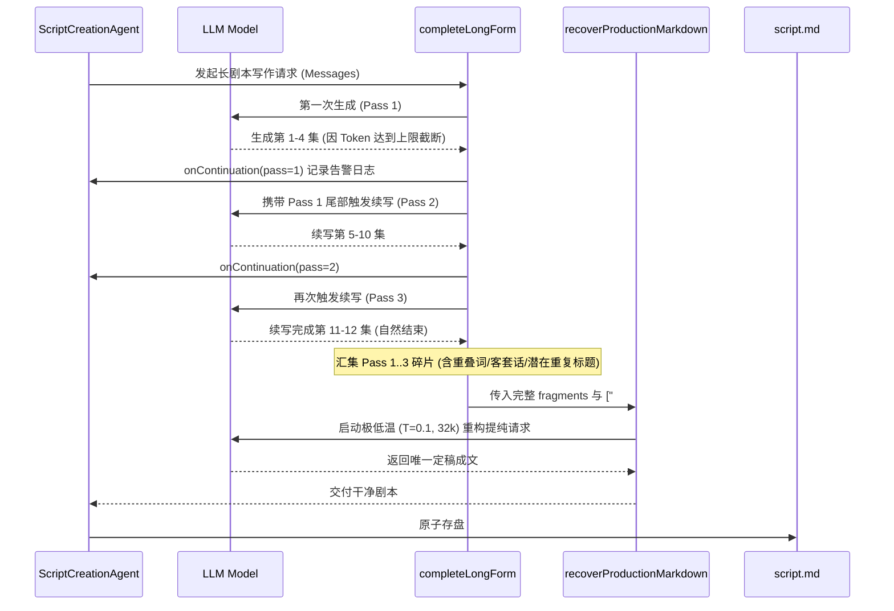

# 线性剧本阶段五：长剧本输出截断续写与低温重构自愈机制（Continuation & Recovery）深度分析报告

> **源工程**：`inkos/`（LLM Engine: `long-form-completion.ts`，Agent: `ScriptCreationAgent`）  
> **核心源文件**：
> - `inkos/packages/core/src/agents/script-storyboard.ts` (`recoverProductionMarkdown`, `writeScript`)
> - `inkos/packages/core/src/llm/long-form-completion.ts` (`completeLongForm`)
> - `inkos/packages/core/src/__tests__/long-form-completion.test.ts`

---

## 1. 阶段概述

在当前大模型底层架构下，单次请求的最大输出 Token 上限（通常为 4096 至 8192 Tokens）是**全自动生成分集工业长剧本的最大物理瓶颈**。一部 12 集的微短剧或单集电视剧本正文往往达到 1.5 万至 3 万字，单次调用必然会在半山腰发生截断。传统的简单字符串拼接往往会导致：**重复输出上一句末尾、重写开头小节、夹带“以下是为您续写的内容”等模型自述客套话，甚至导致 Markdown 语法撕裂**。InkOS 在底层研发了专有的 **`completeLongForm` 续写驱动 + `recoverProductionMarkdown` 低温自愈重构机制**，实现了工业长剧本的零截断、零重复、无感平滑生成。

---

## 2. 执行主体与角色编排

- **LongFormCompletion Engine（长文本补全引擎）**：底层驱动，负责检测 LLM 的输出截断信号，循环挂起并携带上文触发 continuation pass。
- **ScriptCreationAgent**：上层编剧智能体，提供标准编写 Prompt 与续写日志记录（`onContinuation`）。
- **Production Recovery Channel（生产恢复通道）**：在所有续写碎片（fragments）收集完毕后介入的专用提纯管道，执行语义重构。

---

## 3. 输入契约与上下文来源

- **多轮续写输出碎片（Fragments）**：
  包含 Pass 1、Pass 2、Pass 3 收集到的全部原始流式输出片段（可能包含思考过程、格式包装、接续重叠词）。
- **目标语言（Language）**：`zh` | `en`。
- **法定标题锚点（Required Headings）**：
  中文锚点：`["## 人物", "## 剧本正文"]`；
  英文锚点：`["## Characters", "## Script"]`。

---

## 4. 输出产物与权威形态

- **唯一规范成稿（Canonical Production Document）**：
  经过提纯自愈后的单一标准完整 Markdown 剧本正文，消除了所有续写痕迹与包装废话，保留了最完整、最具可用性的正文。

---

## 5. 核心流转机制与关键算法

### 5.1 完整自愈流转时序图



### 5.2 续写截断检测引擎（completeLongForm）
```typescript
// packages/core/src/agents/script-storyboard.ts:96
const response = await completeLongForm({
  messages,
  language,
  generate: (continuationMessages) => this.chat(continuationMessages, {
    temperature: 0.55,
    maxTokens: this.ctx.client.defaults.maxTokens,
  }),
  onContinuation: (pass) => this.log?.warn(`[script] Output limit reached; continuing pass ${pass}.`),
  recoverAfterContinuation: (fragments) => this.recoverProductionMarkdown(
    fragments,
    language,
    language === "en" ? ["## Characters", "## Script"] : ["## 人物", "## 剧本正文"],
  ),
});
```

### 5.3 低温生产重构通道（recoverProductionMarkdown）
系统并不信任模型的暴力拼接，而是通过专门设计的**生产恢复提示词**进行清洗：
```typescript
// packages/core/src/agents/script-storyboard.ts:52
private async recoverProductionMarkdown(
  fragments: string,
  language: "zh" | "en",
  requiredHeadings: readonly string[],
): Promise<string> {
  const response = await this.chat([
    {
      role: "system",
      content: language === "en"
        ? [
            "You recover one canonical production document after a transport-confirmed output-limit continuation.",
            "The fragments may contain scratch analysis, overlapping suffixes, and complete-document restarts.",
            "Return exactly one complete Markdown deliverable. Preserve the user's requirements and the most developed usable content; remove process notes, scratch analysis, wrappers, duplicate document roots, and repeated sections.",
            "Do not summarize or shorten the actual deliverable.",
          ].join("\n")
        : [
            "你负责在模型因输出上限续写后，恢复唯一一份规范生产文档。",
            "输入片段可能包含思考草稿、重叠后缀和从头重写的完整文档。",
            "返回且只返回一份完整 Markdown 交付稿。保留用户要求和完成度最高的可用内容；删除流程说明、思考草稿、包装文本、重复文档开头和重复小节。",
            "不得概括或缩短实际交付内容。",
          ].join("\n"),
    },
    {
      role: "user",
      content: [
        language === "en" ? "## Required Headings" : "## 必需标题",
        ...requiredHeadings.map((heading) => `- ${heading}`),
        "",
        language === "en" ? "## Output Fragments" : "## 输出片段",
        fragments,
      ].join("\n"),
    },
  ], {
    temperature: 0.1,    // 极低温度，防止二次自由发挥产生幻觉
    maxTokens: 32_000,    // 极高上限，确保一次性容纳提纯后全剧本
  });
  return response.content.trim();
}
```

### 5.4 四大清洗提纯铁律
恢复通道严格执行四项指令：
1. **删除流程与包装说明**：剔除所有“以下是第 5 集的续写……”、“我们继续上面被截断的台词……”；
2. **消除重叠后缀与重新开头**：若 Pass 2 愚蠢地从头重新输出了“第 1 集”，自动比对并保留完成度更高、剧情推进更深入的一版；
3. **消除重复根小节**：全篇严格保留唯一的 `## 人物` 和唯一的 `## 剧本正文`；
4. **禁止概括删减（Do not summarize）**：字字必保，严禁将具体对白缩写成“两人发生激烈争执后和解”。

---

## 6. 质量门禁与强校验规则

1. **法定标题存在性二次断言**：
   - 重构后的交付稿必须包含指定的 `requiredHeadings`，若依然缺失，直接抛出 `Failed to recover production document` 异常。
2. **极低温度确定性（T = 0.1）**：
   - 恢复步骤禁止使用默认温度（0.55+），强制锁定 0.1，确保模型只做“文本无损重构”，不修改角色的任何一句对白。

---

## 7. 一致性与因果链保障

- **无缝衔接一致性**：
  由于消除了断点处的重叠词和残缺句子，演员排演或导演审阅时感受不到任何 AI 调用的断层，整部剧本呈现出如同单一作者一气呵成的因果连贯性。

---

## 8. 测试覆盖与验证场景

主要测试位于 `inkos/packages/core/src/__tests__/long-form-completion.test.ts`：
- **碎片合成测试**：构造含有重复段落、客套过渡语的剧本片段集合，验证 `recoverProductionMarkdown` 能够准确输出单一份干净连续的剧本文档，且总集数无损保留。
