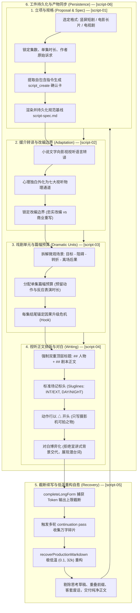

# InkOS 源工程纯线性影视/短剧剧本流程各阶段深度分析总揽与研究索引

> **源工程**：`inkos/`（Profile: `script`，能力行: `script.spec`, `script.scenes` 等）  
> **核心源码**：`packages/core/src/pipeline/script-storyboard-runner.ts` (`runScriptCreation`)、`agents/script-storyboard.ts` (`ScriptCreationAgent`)、`skills/inkos-script-writing/`  
> **整理位置**：`docs/inkos/script-pipeline-analysis.md`  
> **剧本全链路**：立项与创作规格 → 小说媒介转译与改编边界 → 戏剧单元与分集预算 → 视听化分场正文排版 → 长剧本续写与低温重构自愈 → 工件持久化与产物同步  
> **核心原则**：视听绝对外化原则、戏剧单元四要素闭环原则、对白博弈而非宣讲原则、长文本零截断无损自愈原则。

---

## 目录

1. [一、纯线性剧本流水线 6 个专项研究索引矩阵](#一纯线性剧本流水线-6-个专项研究索引矩阵)
2. [二、纯线性剧本流水线全景图与生产流程](#二纯线性剧本流水线全景图与生产流程)
3. [三、源工程纯剧本核心设计哲学与四大铁律](#三源工程纯剧本核心设计哲学与四大铁律)
4. [四、线性剧本六大阶段深度归纳与技术解构](#四线性剧本六大阶段深度归纳与技术解构)
5. [五、纯线性剧本全流程八维度对比归纳矩阵](#五纯线性剧本全流程八维度对比归纳矩阵)
6. [六、纯剧本特有的三大核心横向工程护栏](#六纯剧本特有的三大核心横向工程护栏)
7. [七、小说长篇流程 vs 纯线性剧本流程机制横向对比](#七小说长篇流程-vs-纯线性剧本流程机制横向对比)
8. [八、对 DSH 剧本能力复刻的系统性启示](#八对-dsh-剧本能力复刻的系统性启示)

---

## 一、纯线性剧本流水线 6 个专项研究索引矩阵

本套研究彻底剥离了分支游戏与分镜生图的干扰，纯粹聚焦于**由原著小说/大纲向标准工业影视/短剧分场剧本转译的端到端创作链路**。各阶段独立深度技术报告保存在当前目录下：

| 阶段序号 | 阶段名称与定位 | 专项深度研究报告链接 | 核心源码模块与位置 | 主责角色 / 引擎 | 关键产物（权威 vs 交付） | 核心质量门禁 / 阻断断言 |
| :---: | :--- | :--- | :--- | :--- | :--- | :--- |
| **01** | **立项与创作规格** Proposal & Spec | [script-01-proposal-spec.md](./script-01-proposal-spec.md) | `pipeline/script-storyboard-runner.ts` `agents/script-storyboard.ts` | Creative Agent `propose_action` | **规格书**：`script-spec.md` (包含 Goal, Brief, Source) | **Workflow Start Gate** 自包含指令校验；禁止覆盖已存在剧本工程 |
| **02** | **媒介转译与改编边界** Adaptation Boundary | [script-02-adaptation-boundary.md](./script-02-adaptation-boundary.md) | `skills/inkos-script-writing/` `builtin-profiles.ts` (`script`) | ScriptCreationAgent Adaptation Guard | **转译契约**：视听外化通道 **动作线**：`Action Spine` | **禁心穿门禁** 动作行严禁心理活动；保留原著核心因果脊柱 |
| **03** | **戏剧单元与篇幅预算** Dramatic Units | [script-03-dramatic-units-budget.md](./script-03-dramatic-units-budget.md) | `skills/inkos-script-writing/references/` `episode-scene-craft.md` | ScriptCreationAgent Episode Budget Allocator | **节拍表**：分集场景清单 **单集契约**：进出场情势差 | **拒绝无后果水戏** 预留动作反应时间；结尾升级危机（Hook）门禁 |
| **04** | **视听正文与博弈对白** Screenplay Writing | [script-04-screenplay-writing.md](./script-04-screenplay-writing.md) | `agents/script-storyboard.ts` `buildScriptCreationSystemPrompt` | ScriptCreationAgent (专业主笔) | **剧本成文**：`script.md` (包含 Characters 与 Script) | **法定双标题强检** `## 人物` 与 `## 剧本正文`；拒绝解说式台词 |
| **05** | **截断续写与低温自愈** Continuation & Recovery | [script-05-continuation-recovery.md](./script-05-continuation-recovery.md) | `agents/script-storyboard.ts` `llm/long-form-completion.ts` | Recovery Channel (低温重构通道) | **提纯稿**：单一份规范 Markdown (零思考草稿、零重叠词) | **无损提纯断言** 低温 (0.1) 防二次幻觉；禁止概括缩减剧情 |
| **06** | **工件持久化与同步** Persistence & Sync | [script-06-persistence-sync.md](./script-06-persistence-sync.md) | `harness/work-store.ts` `harness/source-sync.ts` | PipelineRunner SourceSync Engine | **物理工件**：`script.md` **清单注册**：`WorkManifest` | **残卷拦截门禁** 正文必须 $\ge 500$ 字符；SHA-256 哈希防篡改 |

---

## 二、纯线性剧本流水线全景图与生产流程

---

## 三、源工程纯剧本核心设计哲学与四大铁律

### 1. 视听绝对外化原则（Audio-Visual Exteriorization）
- 剧本是供摄制组执行的技术图纸，**绝对没有“心理活动”的容身之地**；
- 角色的一切痛苦、挣扎、隐秘仇恨，必须强制转换为**具体的眼神、微动作、空间走位（Blocking）、道具损坏、物证核验或环境音效**；动作行（Action lines）只记录摄影机能拍、麦克风能录、演员能演的内容。

### 2. 戏剧单元闭环铁律（The 4 Elements of Dramatic Units）
- 拒绝流水账：任何一场戏绝不能仅仅是“两个人坐下来聊天”；
- 每一个独立场次必须包含四个因果支点：**可演出的即时目标（Objective） $\rightarrow$ 强阻力对抗（Resistance） $\rightarrow$ 戏剧节拍转折（Turn） $\rightarrow$ 不可逆离场后果（Exit Condition）**。

### 3. 对白博弈而非宣讲原则（Dialogue as a Weapon）
- 严禁角色像宣读百科全书一样对彼此灌输已知背景（**No Exposition Dump**）；
- 对白是争夺对话主导权的武器，字面之下的**潜台词（Subtext）**远大于表面文字，背景信息必须在谎言被戳穿或严厉逼问的压力下被动露出。

### 4. 长文本零截断无损自愈铁律（Lossless Continuation Recovery）
- 绝不信任大模型在发生截断时的粗暴头尾拼接；
- 必须通过**双标题锚点（`## 人物` 与 `## 剧本正文`）**驱动专有的低温提纯恢复通道，在消除冗余客套话的同时**严禁概括删减正文**，保证上万字剧本一气呵成。

---

## 四、线性剧本六大阶段深度归纳与技术解构

### 阶段一：立项提议、格式选型与创作规格书（[script-01-proposal-spec.md](./script-01-proposal-spec.md)）
- **核心定位**：解决交付格式（竖屏短剧、电影长片、电视剧）、集数时长与制作边界锁定问题。
- **技术要点**：通过 `propose_action(script_create)` 生成自包含执行指令（`instruction`）；渲染出法定基准文档 `script-spec.md`；绑定 `authorRequest`（不可撼动的作者原始意图）与 `productionBrief`（制作工艺方案）。

### 阶段二：小说到剧本的媒介转译与改编边界（[script-02-adaptation-boundary.md](./script-02-adaptation-boundary.md)）
- **核心定位**：解决从“小说文字”到“影视镜头”的媒介物理转译。
- **技术要点**：推行内心独白外化的七大通道（具体行为、话语机锋、走位距离、道具借代、物理证据、环境声音、破坏后果）；执行改编边界控制（保留原著因果脊柱、人际关系与视角禁忌，严禁擅自商改）。

### 阶段三：戏剧单元四要素与分集篇幅预算（[script-03-dramatic-units-budget.md](./script-03-dramatic-units-budget.md)）
- **核心定位**：微观保障场场有冲突，宏观保障集集有节奏。
- **技术要点**：为竖屏短剧等分配严格的时长预算，预留动作与反应（Action & Reaction）表演时间；每集结尾强制设置升级危机钩子（Ending Hook）；控制单集登场人物与场景成本（Production Clarity）。

### 阶段四：视听化分场正文排版与博弈对白艺术（[script-04-screenplay-writing.md](./script-04-screenplay-writing.md)）
- **核心定位**：产出符合行业工业标准的成熟分场剧本成稿。
- **技术要点**：强制双重顶层标题（`## 人物` + `## 剧本正文`）；场景标头（Sluglines：INT/EXT, DAY/NIGHT）；动作行以 `△` 开头；对白博弈化；证据修改必须区分“错误原值”与“核实真值”，具体展现核查过程。

### 阶段五：长剧本输出截断续写与低温重构自愈机制（[script-05-continuation-recovery.md](./script-05-continuation-recovery.md)）
- **核心定位**：彻底攻克大模型单次输出 Token 上限导致的长剧本截断难题。
- **技术要点**：`completeLongForm` 监控截断并触发多轮 pass；收集碎片后调用 `recoverProductionMarkdown`，在 `temperature: 0.1` 极低温度与 32k 上限下一次性消除思考草稿与重叠词，产出唯一无损成稿。

### 阶段六：剧本工件持久化与工程产物同步（[script-06-persistence-sync.md](./script-06-persistence-sync.md)）
- **核心定位**：剧本成稿的物理安全存盘与全局清单版本跟踪。
- **技术要点**：执行 `assertNonEmptyArtifacts`（正文必须 $\ge 500$ 字符）；通过 `syncWorkSourceArtifacts` 原子更新磁盘文件并写入 `WorkManifest`；计算 SHA-256 校验和防篡改。

---

## 五、纯线性剧本全流程八维度对比归纳矩阵

| 分析维度 | 01. 立项与规格 | 02. 改编转译边界 | 03. 戏剧单元预算 | 04. 视听正文排版 | 05. 截断续写自愈 | 06. 工件持久化同步 |
| :--- | :--- | :--- | :--- | :--- | :--- | :--- |
| **① 阶段定位** | 选型、篇幅与预算锚定 | 小说向影视动作转译 | 场景四要素与分集节拍 | 工业分场剧本成稿生成 | 万字超长输出无损提纯 | 资产持久化与版本哈希 |
| **② 执行主体** | Creative Agent 制片人 | ScriptCreationAgent Adaptation Guard | ScriptCreationAgent Budget Allocator | ScriptCreationAgent (专业主笔) | Recovery Channel (低温提纯通道) | PipelineRunner SourceSync Engine |
| **③ 输入契约** | 原素材大纲/概念 集数时长预算 | 小说原著正文 改编模式授权 | 规格书时长指标 起承转合事件链 | 分集节拍表、人物表 视听写作技能指引 | 多轮续写碎片集合 法定标题锚点 | 提纯后的正文与规格 项目 Project ID |
| **④ 输出权威** | `script-spec.md` (规格工件权威) | 视听化行动线 (Action Spine) | 分集剧纲与节拍表 场次情势差分 | 标准格式分场剧本 `script.md` | 唯一定稿 Markdown (零杂质正文) | `works/<id>/source/` `WorkManifest` 注册记录 |
| **⑤ 核心机制** | 动作自包含封装 制作方案双层展开 | 七大视听外化通道 动作行禁令约束 | 戏剧单元四要素模型 动作与反应预算律 | 法定双标题排版 对白博弈与证物核查 | `completeLongForm` 极低温 (0.1) 重构提纯 | 非空与最小字数硬检 SHA-256 校验和计算 |
| **⑥ 质量门禁** | 禁止覆盖既有工程 格式白名单匹配 | 动作行动词全知禁令 核心因果脊柱一致性 | 拒绝无后果水场景 单集字数配比硬检 | 法定双标题强检 严禁模型前言废话 | 必需标题存在性二次断言 无损提纯禁止概括 | 残卷拦截（字数 $\ge 500$） 原子 Rename 提交锁 |
| **⑦ 一致性保障** | 规格即首个 Artifact | 角色行动支点守恒 | 分集悬念因果承接 | 场次时空与道具物理守恒 | 碎片无缝拼接消除断层 | 哈希防篡改与版本可溯 |
| **⑧ 文学考量** | 锚定制作工业边界 | 摄影机只拍可感之物 | 结尾升级危机（Hook） | 视听留白与深层潜台词 | 保证长篇结构一气呵成 | 开箱即用交付围读排演 |

---

## 六、纯剧本特有的三大核心横向工程护栏

### 6.1 低温生产重构自愈通道（recoverProductionMarkdown）
- **技术突破**：面对大模型长文本截断，InkOS 拒绝任何基于规则或正则的脆弱字符串剪裁，而是开辟了一个**只做无损结构提纯的专用 LLM 恢复通道**；
- **确定性控制**：锁定 `temperature: 0.1`，严格依托 `## 人物` 与 `## 剧本正文` 两个锚点，自动识别完成度最高的分集版本，消灭所有重叠词与思考噪音。

### 6.2 规格书与改编边界的双层锚定（Author Request vs Production Brief）
- **作者原始约束（Author Request）**：记录作者不可动摇的底线（如“核心结局男主必须死亡”），作为最高级别不可篡改的法律条款；
- **制作方案（Production Brief）**：允许编剧智能体在作者框架内自由发挥专业的视听技巧，达成工业化编剧与作者意图的完美平衡。

### 6.3 工业级开箱即用工件模型（Delivery-Ready Artifact Model）
- 最终落盘的 `script.md` 杜绝任何 AI 标记；
- 严格遵循现代影视工业排版格式：场号、场景标头（INT/EXT）、动作行（△）、角色名、括号提示、博弈对白，直接打印即可进入剧组围读会。

---

## 七、小说长篇流程 vs 纯线性剧本流程机制横向对比

| 机制维度 | 小说长篇流水线（Longform Novel） | 纯线性影视/短剧剧本流水线（Linear Script） |
| :--- | :--- | :--- |
| **核心媒介形态** | 纯文字小说章节（连载网络文学） | 工业分场剧本（影视/微短剧拍摄台本） |
| **篇幅单位** | 章（Chapter）、卷（Volume） | 场（Scene）、集（Episode） |
| **描写核心原则** | 展现（Show）与心理活动、环境氛围并重 | **绝对视听外化**：只写真实可拍、可演出的物理动作 |
| **台词功能** | 塑造人设、交代世界观、推进剧情 | **博弈工具**：争夺控制权、展现潜台词，严禁宣讲解说 |
| **长文本应对机制** | 上下文分层治理（Composer）+ 滚动快照 | **多轮续写（completeLongForm）+ 低温重构自愈** |
| **核心门禁校验** | 行号引文审稿（Review）、伏笔状态机对账 | **法定双标题强检**、动作行禁心穿、残卷最小字数硬检 |
| **下游交付终端** | 电子书（EPUB）、TXT、网文排版 Markdown | 摄制组导演台本、演员围读台词本、分镜头脚本底本 |

---

## 八、对 DSH 剧本能力复刻的系统性启示

根据项目 `AGENTS.md` 铁律与源工程保真原则，在向 DSH（DeepSeek-Harness）复刻纯剧本能力时，应恪守以下实现基线：

1. **账本行精确承载**：
   - 纯线性剧本严格对应 `capabilities.yaml` 中的 `script.spec`（规格书）与 `script.scenes`（分场正文），在长篇 v1 完成后作为独立纵向能力交付。
2. **长文本恢复通道等价实现**：
   - 在 DSH 运行时中，完整移植 `completeLongForm` 续写检测与 `recoverProductionMarkdown` 重构提示词，确保在 deepseek-chat 等模型输出截断时能够自动完成长剧本的无缝自愈。
3. **技能注入与阶段分离**：
   - 将 `inkos-script-writing` 的视听外化原则作为创作技能通过 `systemPrompt.context()` 注入，剧本工具面只暴露纯文本输出通道，不给编剧 Agent 多余的写文件权限。
