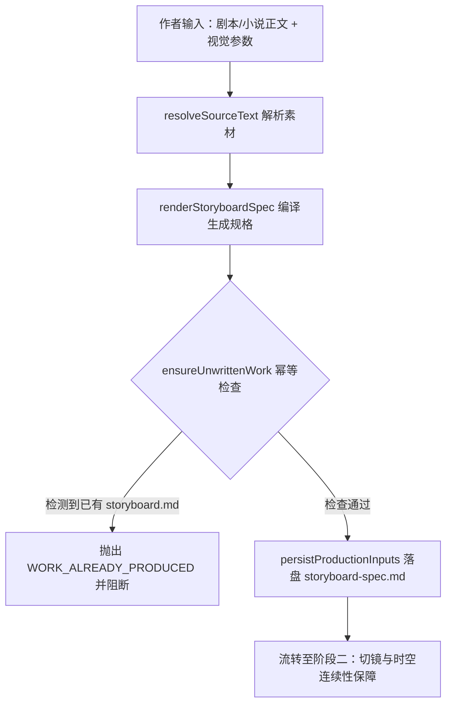

# 分镜与生图阶段一：分镜立项、视觉参数与创作规格书（Storyboard Spec & Visual Parameters）深度分析报告

> **源工程**：`inkos/`（Profile: `storyboard`，能力行: `storyboard`）  
> **核心源文件**：
> - `inkos/packages/core/src/pipeline/script-storyboard-runner.ts` (`runStoryboardCreation`, `renderStoryboardSpec`)
> - `inkos/packages/core/src/agents/script-storyboard.ts` (`StoryboardCreationInput`, `renderStoryboardSpec`)
> - `inkos/packages/core/src/harness/builtin-profiles.ts` (`id: "storyboard"`)
> - `inkos/packages/core/src/__tests__/script-storyboard.test.ts`

---

## 1. 阶段概述

分镜与生图（Storyboard & Image Generation）流水线的第一阶段是**从小说章节或剧本正文中确立视觉呈现的物理参数、艺术风格基调与镜头预算边界**。与纯文学创作不同，影视分镜必须直接对接下游的美术概念设计、文生图（Text-to-Image）模型调用或摄影摄制。在动笔切镜前，必须将用户抽象的视觉诉求（如“要赛博朋克风”、“画面要竖屏适合短剧”）形式化为机器与模型共同遵循的《分镜创作规格书》（`storyboard-spec.md`）。该文档确立了画幅比例、镜头密度、视觉风格基线与硬性镜头数上限，作为后续切镜与生图提示词提纯的法定准绳。

---

## 2. 执行主体与角色编排

- **人类导演 / 视觉总监（Director / Visual Creator）**：提供原始剧本或小说文本，指定画幅比例（Aspect Ratio）、视觉风格（Visual Style）、切镜粒度（Granularity）与镜头上限（Max Shots）。
- **Creative Assistant / Storyboard Spec Engine**：解析用户指令，提取并融合视觉参数（`mergeRequirements`），调用 `renderStoryboardSpec` 生成格式化的 Markdown 规格书。
- **PipelineRunner（流水线编排器）**：
  - 调用 `resolveSourceText` 解析工作区内或用户直接输入的素材；
  - 调用 `ensureUnwrittenWork` 校验该作品尚未生成过正式分镜（`profileId === "storyboard"` $\rightarrow$ 检查 `source/storyboard.md`），若存在则抛出 `WORK_ALREADY_PRODUCED` 异常阻断覆盖；
  - 调用 `persistProductionInputs` 将 `storyboard-spec.md` 写入磁盘 `works/<projectId>/source/`。

---

## 3. 输入契约与上下文来源

### 3.1 核心参数接口（StoryboardCreationInput）

```typescript
export interface StoryboardCreationInput {
  readonly authorRequest?: string;     // 作者原始自然语言诉求
  readonly title: string;              // 作品标题
  readonly sourceKind?: string;         // 源素材类型（剧本/小说/大纲）
  readonly sourceText?: string;         // 完整待拆解正文
  readonly requirements?: string;       // 融合后的详细制作要求
  readonly visualStyle?: string;        // 视觉风格（如 "写实冷色"、"赛博朋克"、"水墨国风"）
  readonly aspectRatio?: string;        // 画幅比例（如 "16:9", "9:16", "2.39:1", "1:1"）
  readonly granularity?: string;        // 切镜粒度（如 "按剧本节拍", "逐动作拆解", "重点关键帧"）
  readonly maxShots?: number;           // 镜头数量硬上限（防止死循环或 Token 爆炸）
  readonly language?: "zh" | "en";      // 输出语言规范
}
```

### 3.2 规格书持久化渲染（renderStoryboardSpec）

`script-storyboard.ts` 源码中给出的规格书渲染逻辑，保证了 Markdown 文档具有确定性结构：

```markdown
# {title} 分镜规格

## 目标
- 交付物：完整分镜稿与配套生图提示词
- 视觉风格：{visualStyle || "未指定；根据源素材与要求判断"}
- 画面比例：{aspectRatio || "未指定"}
- 分镜粒度：{granularity || "未指定"}
- 镜头数量上限：{maxShots || "未指定"}

## 制作说明
{authorRequest}
以下说明展开创作任务；其中补充的制作选择可在作者约束内调整。
{requirements}

## 源素材说明
源素材：{sourceKind || "未指定"}
```

---

## 4. 阶段产物与权威形态

| 产物文件 | 物理存储位置 | 权威性质 | 核心内容与结构 |
| :--- | :--- | :--- | :--- |
| **创作规格书** | `works/<projectId>/source/storyboard-spec.md` | **法定输入约束** | 锁定视觉风格、比例、最大镜头数与制作要求。后续 Agent 严禁突破此边界。 |
| **原始输入缓存** | 内存 / `persistProductionInputs` | 临时工作源 | 保持原始小说/剧本正文纯净，不直接修改输入源。 |

---

## 5. 核心流转逻辑与控制流



---

## 6. 质量门禁与断言守卫

1. **工作区排他与幂等防穿透（ensureUnwrittenWork）**：
   - 检查 `loadWorkManifest` 中是否存在当前修订的 `source/storyboard.md`；
   - 严禁流水线在未显式确认重写或版本回滚的情况下，覆盖已交付的视觉分镜资产。
2. **镜头预算硬上限锁（maxShots Guard）**：
   - 若用户指定 `maxShots: 20`，系统在渲染 User Prompt 时会注入强约束：`"镜头数量上限：最多 20 个镜头。优先覆盖核心戏剧节拍，不要为了凑数拆分琐碎动作。"`。
3. **画幅比例硬注入（Aspect Ratio Guard）**：
   - 指定的画面比例将直接贯穿至后续的文生图请求（如 `1024x1024` for 1:1, `1024x1792` for 9:16, `1792x1024` for 16:9）。

---

## 7. 与 DSH 复刻的映射启示

- **DSH 落点**：`storyboard.spec` 注册为阶段工具或面板配置表单；
- **参数卡设计**：在 DSH React Client 面板上提供直观的画幅选择器（16:9 影视横屏 / 9:16 短剧竖屏）、风格预设下拉框（二次元、写实电影、暗黑奇幻）以及镜头预算滑块；
- **确认机制**：通过 DSH `approval` 服务产生 `storyboard_create` 动作回执，将 `storyboard-spec.md` 落盘至工作区。
