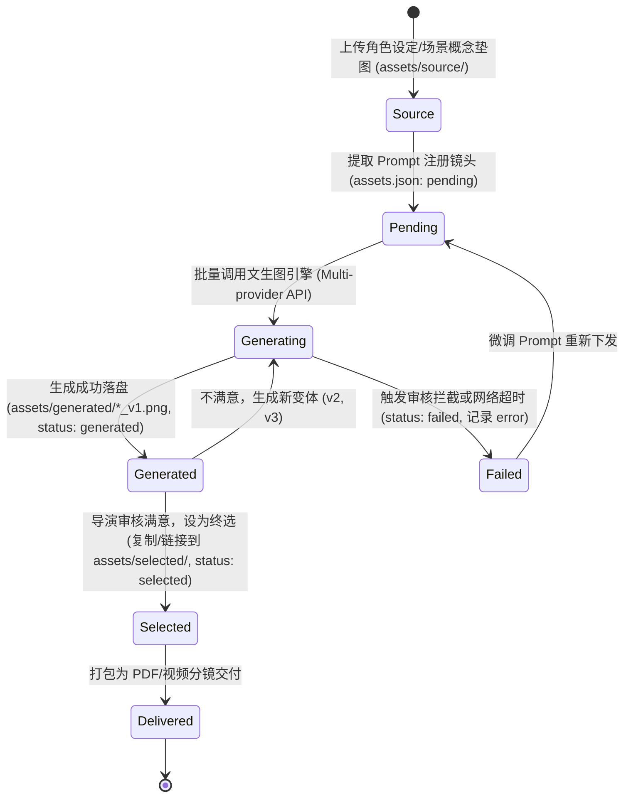

# InkOS 源工程分镜与生图（Storyboard & Image Generation）流程各阶段深度分析总揽与研究索引

> **源工程**：`inkos/`（Profile: `storyboard`，能力行: `storyboard` / `script.scenes`）  
> **核心源码**：
> - `packages/core/src/pipeline/script-storyboard-runner.ts` (`runStoryboardCreation`, `createStoryboardAssetsManifest`)
> - `packages/core/src/agents/script-storyboard.ts` (`StoryboardCreationAgent`)
> - `packages/core/skills/inkos-storyboard/` (`SKILL.md`, `references/shot-continuity.md`)
> - `packages/core/src/llm/cover-providers.ts`
> - `packages/core/src/pipeline/short-fiction-runner.ts` (`generateImageFromPrompt`)
> **整理位置**：`docs/inkos/storyboard/storyboard-pipeline-analysis.md`  
> **分镜生图全链路**：视觉规格立项 → 节拍切镜与视听连续性 → 生图 Prompt 提纯与单瞬间冻结 → 资产清单与目录三态隔离 → 底层多 Provider 生图调度 → 工件持久化与 DSH 复刻  
> **核心设计哲学**：镜头服务于节拍位移、跨镜视听时空连续性追踪、文生图静态瞬间单帧冻结、多模态资产物理三态隔离（Source / Generated / Selected）。

---

## 目录

1. [一、分镜与生图流水线 6 个专项研究索引矩阵](#一分镜与生图流水线-6-个专项研究索引矩阵)
2. [二、分镜与生图流水线全景架构图与数据流](#二分镜与生图流水线全景架构图与数据流)
3. [三、源工程分镜生图四大工业设计铁律](#三源工程分镜生图四大工业设计铁律)
4. [四、分镜与生图全流程八维度技术解构矩阵](#四分镜与生图全流程八维度技术解构矩阵)
5. [五、长篇小说 vs 纯线性剧本 vs 分镜生图机制三维横向对比](#五长篇小说-vs-纯线性剧本-vs-分镜生图机制三维横向对比)
6. [六、分镜资产目录三态生命周期演进模型](#六分镜资产目录三态生命周期演进模型)
7. [七、对 DSH 架构复刻的系统性实施指引](#七对-dsh-架构复刻的系统性实施指引)

---

## 一、分镜与生图流水线 6 个专项研究索引矩阵

本套技术研究彻底将分镜与图像生成从分支游戏与纯文本剧本中独立出来，深度剖析了源工程如何将自然语言叙事精准编译为工业级视听分镜总表及可批量生图的资产体系：

| 序号 | 报告文件与链接 | 核心研究主题 | 源工程核心源码与落点 | 核心机制与输入输出契约 |
| :---: | :--- | :--- | :--- | :--- |
| **01** | [storyboard-01-spec-parameters.md](./storyboard-01-spec-parameters.md) | **分镜立项、视觉参数与创作规格书** | `script-storyboard-runner.ts` `script-storyboard.ts` `renderStoryboardSpec` | 锁定画幅比例（16:9/9:16）、视觉风格、切镜粒度与最大镜头数上限（`maxShots`）；`ensureUnwrittenWork` 防覆盖守卫；落盘法定准绳 `storyboard-spec.md`。 |
| **02** | [storyboard-02-shot-breakdown-continuity.md](./storyboard-02-shot-breakdown-continuity.md) | **叙事节拍切镜与视听时空连续性保障** | `skills/inkos-storyboard/SKILL.md` `references/shot-continuity.md` | **镜头服务于节拍**（信息/权力/注意力/情绪变化才切镜）；视听时空连续性 7 大锚点（180°轴线、视线交锋、人物站位、道具、环境光影）；景别与运镜语法规范。 |
| **03** | [storyboard-03-prompt-engineering-frozen-moments.md](./storyboard-03-prompt-engineering-frozen-moments.md) | **面向生图引擎的 Prompt 提纯与单瞬间冻结** | `StoryboardCreationAgent` `StoryboardPackageToolSchema` `renderImagePrompts` | **时空单瞬间冻结法则**：动态镜头中抽取单帧高光瞬态；主体、动作、环境、构图、光影、色调、连续性七维显式解耦；严禁抽象故事概括；镜头与提示词下标强一致。 |
| **04** | [storyboard-04-asset-manifest-directory.md](./storyboard-04-asset-manifest-directory.md) | **资产清单驱动与目录三态生命周期隔离** | `createStoryboardAssetsManifest` `ensureProjectDir` `assets.json` | 物理三态目录（`source/` 垫图参考、`generated/` 候选变体池、`selected/` 终选权威）；`assets.json` 清单管理镜头状态机（pending/generated/selected/failed）。 |
| **05** | [storyboard-05-multi-provider-batch-generation.md](./storyboard-05-multi-provider-batch-generation.md) | **底层多 Provider 调度与批量生图引擎** | `cover-providers.ts` `short-fiction-runner.ts` `node-image.ts` | 统一抽象层适配 OpenAI（DALL-E 3）、Google（Imagen 3）、KkaiAPI；画幅尺寸自动映射；Base64 强类型解码与二进制落盘；批量并发与单镜头异常故障隔离。 |
| **06** | [storyboard-06-artifact-persistence-dsh-mapping.md](./storyboard-06-artifact-persistence-dsh-mapping.md) | **工件持久化、完整性断言与 DSH 复刻映射** | `assertNonEmptyArtifacts` `syncWorkSourceArtifacts` `work-store.ts` | 非空断言守卫；基于 SHA-256 的源工件增量同步；`WorkManifest` 版本注册；DSH 运行时子代理、生图工具注册与 React 九宫格分镜工作台落地。 |

---

## 二、分镜与生图流水线全景架构图与数据流

```mermaid
flowchart TD
    subgraph S1["1. 视觉规格确立 (Spec Phase)"]
        A["输入：原著小说/剧本正文 + 视觉要求"] --> B["解析素材与视觉风格参数 (visualStyle, aspectRatio, maxShots)"]
        B --> C["renderStoryboardSpec 渲染规格"]
        C --> D{"ensureUnwrittenWork 幂等校验"}
        D -- "通过" --> E["落盘 source/storyboard-spec.md"]
    end

    subgraph S2["2. 节拍切镜与连续性推演 (Breakdown Phase)"]
        E --> F["StoryboardCreationAgent 启动"]
        F --> G["加载 inkos-storyboard 技能与 shot-continuity 规则"]
        G --> H["戏剧节拍位移识别：信息差/权力消长/注意力转移"]
        H --> I["时空连续性保障：180°视向轴线、人物站位、道具延续、稳定光影"]
    end

    subgraph S3["3. 提示词提纯与单瞬间冻结 (Prompt Extraction)"]
        I --> J["submit_storyboard_package 结构化提交"]
        J --> K["分镜文档 storyboard.md 提纯 (排印镜头、景别、运镜、台词、音效)"]
        J --> L["imagePrompts 数组提纯 (单瞬间冻结，七维视听语言显式解耦)"]
        L --> M["下标对齐校验：Shot i <===> imagePrompts[i]"]
    end

    subgraph S4["4. 资产清单与目录隔离 (Asset Manifest)"]
        K & M --> N["createStoryboardAssetsManifest 构建资产清单"]
        N --> O["初始化目录物理三态：assets/source/, generated/, selected/"]
        O --> P["编译生成 source/assets.json (注册镜头数组与变体槽位)"]
    end

    subgraph S5["5. 文生图调度与批处理 (Batch Image Generation)"]
        P --> Q["resolveCoverGenerationRequest 解析生图模型与端点"]
        Q --> R["OpenAI (DALL-E 3) / Google (Imagen 3) / KkaiAPI 协议分发"]
        R --> S["尺寸自适应映射 (16:9 -> 1792x1024, 9:16 -> 1024x1792)"]
        S --> T["单镜头异常隔离并发执行 -> Base64 解码 -> 二进制安全写入 assets/generated/"]
        T --> U["回写 assets.json 更新变体状态 (pending -> generated)"]
    end

    subgraph S6["6. 工件持久化与交付 (Delivery Phase)"]
        U --> V["assertNonEmptyArtifacts 非空完整性断言"]
        V --> W["syncWorkSourceArtifacts (计算 SHA-256，原子事务提交)"]
        W --> X["WorkManifest 注册四类工件 (storyboard-spec, storyboard, image-prompt, image)"]
        X --> Y["交付：人类可读分镜 + 机器资产清单 + 完整图像集"]
    end
```

---

## 三、源工程分镜生图四大工业设计铁律

在剖析 `inkos/` 源码后，可以总结出其分镜与生图体系的四大核心设计哲学：

### 铁律一：Shots serve the beat（镜头只服务于戏剧节拍）
切镜的唯一判定标准是**戏剧要素发生了位移**（信息更新、权力消长、空间转移、焦点集中、情绪跃迁）。坚决杜绝“一段文字切一个镜头”的机械切镜，坚决杜绝与叙事无关的纯装饰性空镜头。

### 铁律二：Visual Continuity Anchors（视听连续性硬核锚点追踪）
跨镜头之间必须像工业电影拍摄一样保持严谨的时空逻辑。视线方向严格遵循 180 度轴线定律（对峙双方视线相反）；人物位置相对稳定，移动必须交代轨迹；重复场景必须保留固定的环境锚点（如百叶窗、书柜），防止画面撕裂成不同的世界。

### 铁律三：Frozen Visible Moment（时空单瞬间单帧冻结）
动态镜头是数秒的过程，文生图是 0.01 秒的静态切片。提示词绝不能试图在一张图里塞入一个镜头的全部位移和全套台词，而必须精准捕捉**该镜头中最具戏剧张力的高光瞬间（Peak Dramatic Moment）**。所有提示词必须是物理可见的客观描写，严禁任何抽象主观叙事。

### 铁律四：Three-State Directory Isolation（资产目录物理三态隔离）
严禁将输入素材、候选生成图与终选定稿图混在同一目录：
- `assets/source/` 存放垫图与源参考；
- `assets/generated/` 存放多次生成的候选变体；
- `assets/selected/` 存放唯一选定的终审镜头图。  
全流程由 `assets.json` 强类型状态机精准跟踪。

---

## 四、分镜与生图全流程八维度技术解构矩阵

| 流程阶段 | 1. 视觉规格确立 | 2. 节拍切镜与连续性 | 3. 提示词单瞬间冻结 | 4. 资产清单与三态隔离 | 5. 底层多 Provider 生图 | 6. 持久化与交付 |
| :--- | :--- | :--- | :--- | :--- | :--- | :--- |
| **1. 阶段定位** | 参数形式化与物理边界锁定 | 文学叙事向视听蒙太奇转译 | 动态时空切片向静态单帧提纯 | 多模态资产版本与状态管控 | 跨平台生成式图像调用落地 | 原子同步、断言与成果交付 |
| **2. 主体编排** | 人类导演 + PipelineRunner | `StoryboardCreationAgent` | `StoryboardCreationAgent` | `script-storyboard-runner.ts` | `generateImageFromPrompt` | `syncWorkSourceArtifacts` |
| **3. 输入契约** | `sourceText`, `visualStyle`, `aspectRatio`, `maxShots` | 规格书 + 小说/剧本正文 + `inkos-storyboard` 技能 | 连续分镜正文 + 戏剧高光瞬间 | `imagePrompts` 数组 + 目录配置 | `assets.json` 镜头 prompt + API Key | 四大标准文本工件 + 图片集 |
| **4. 产物形态** | `storyboard-spec.md` (Markdown) | 内存中的分镜节拍流 | `storyboard.md` + `image-prompts.md` | `assets.json` + 三态目录结构 | `assets/generated/*.png` 二进制文件 | `WorkManifest` 修订历史登记 |
| **5. 核心算法** | `renderStoryboardSpec` + 幂等校验 | 轴线追踪与戏剧单元位移检测 | 7 维解耦与 Peak Moment 选取 | 镜头编号标准补齐 (`shot-001`) | 端点自适应解析与 Base64 解码 | SHA-256 校验和与事务提交 |
| **6. Schema** | `StoryboardCreationInput` | 内部结构化分镜对象 | `StoryboardPackageToolSchema` | `StoryboardAssetsManifest` | `CoverProviderPreset` | `TextArtifactWrite[]` |
| **7. 质量守卫** | `ensureUnwrittenWork` (防覆盖) | 景别运镜规范 + 声音画面分离 | 严禁心理描写 + 下标一对一断言 | 目录存在性校验 (`ensureProjectDir`) | 单镜头失败隔离 + 超时熔断 | `assertNonEmptyArtifacts` (非空) |
| **8. 技能方法** | 无（宿主注入） | `inkos-storyboard` / `shot-continuity` | 时空单瞬间选取艺术 | 资产状态机生命周期设计 | 图像参数自适应校正 | DSH 原子写入事务标准 |

---

## 五、长篇小说 vs 纯线性剧本 vs 分镜生图机制三维横向对比

| 机制维度 | 长篇小说流水线 (`longform/`) | 纯线性剧本流水线 (`script-linear/`) | 分镜与生图流水线 (`storyboard/`) |
| :--- | :--- | :--- | :--- |
| **核心媒介目标** | 纯文学长篇连载小说正文 | 供影视拍摄与排演的分场剧本 | 影视前期视觉预演、分镜表与文生图资产 |
| **系统架构模式** | **长生命周期状态机协作环路** | **单步长文本深度提纯流水线** | **多模态图文对齐与资产管线** |
| **角色协同方式** | 8 代理接力（Architect $\rightarrow$ Settler） | 单主笔智能体（`ScriptCreationAgent`） | 分镜主笔 + 多模型生图调度引擎 |
| **状态持久化中枢** | SQLite FTS5 索引 + 双轨单向投影 | 磁盘 Markdown + WorkManifest | `assets.json` 资产清单 + 三态目录树 |
| **最大的技术难点** | 长期叙事因果一致性与历史修订回滚 | 大模型单次输出截断与低温自愈缝合 | **动态镜头时空向静态单帧提示词的冻结转换** |
| **跨阶段依赖** | 每章依赖上一章快照与结算状态 | 仅依赖立项创作规格书 | 严格依赖分镜镜头序号的一对一下标映射 |
| **交付产物形态** | 正文章节 + 状态库 + 伏笔账本 | 规格书 + 分集/分场成文剧本 | **分镜表 + 提示词集 + 资产清单 + 图片文件** |

---

## 六、分镜资产目录三态生命周期演进模型

分镜生产中最核心的状态机流转体现在图像资产上：

---

## 七、对 DSH 架构复刻的系统性实施指引

在将源工程的 `storyboard` 能力复刻至 DeepSeek-Harness (DSH) 时，建议遵循以下实施路径：

1. **子代理与阶段注入（Subagents & Skills）**：
   - 建立 `storyboard` 专有子代理，运行时通过 `systemPrompt.context()` 挂载 `inkos-storyboard` 技能；
   - 注册强类型工具 `submit_storyboard_package` 作为子代理的唯一提交渠道。
2. **生图工具集成（DSH Image Tool Registration）**：
   - 注册 DSH 宿主工具 `storyboard.generate_image`，接收 `prompt`、`size`、`aspectRatio` 与可选的 `referenceImage`；
   - 工具内部封装 OpenAI、Google Imagen 或兼容端点的通信逻辑，直接返回 Base64 或写入工作区 `assets/` 目录。
3. **交互工作台呈现（DSH React Client Panel）**：
   - 在 DSH 作品工作台插件中开辟“分镜与视觉（Storyboard View）”标签页；
   - 提供九宫格镜头流、单镜头 Prompt 在线编辑与重跑、多候选变体对比画廊与一键终选功能。
